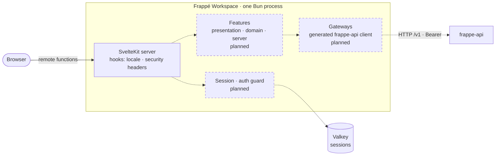

# Frappé Workspace

The console of Frappé, the operating system for restaurants and cafés in Latin America: the web app owners and their
teams work in, in front of [frappe-api](https://github.com/MathiasHilgert/frappe-api).

[Getting started](#getting-started) · [Architecture](#architecture) · [Testing](#testing) ·
[Conventions](#conventions) · [Documentation](#documentation)

## About

Frappé Workspace is a SvelteKit app on Bun that works as a strict backend for frontend (BFF): the browser only ever talks
to this app, and only its server talks to frappe-api. The session, the API token, the error mapping and the locale
live in one place on the server; the browser receives views, never API types or credentials.

**Status: early.** The toolchain is in place, the app ships as a distroless image and every pull request runs the CI.
The configuration is validated at start, every response carries security headers and a nonce-based CSP, and unexpected
errors reach the browser as a safe message with a trace id. Next come the UI primitives.

## Architecture

The target shape, which the boundary rules already enforce. Dashed nodes are planned and do not exist yet.



- **One door to the API.** Remote functions will be the only data path from the browser, and gateways under each
  feature's `server/` the only code that calls frappe-api. SvelteKit refuses to bundle a `server/` module into the client.
- **Features own their layers.** No feature exists yet. Each one will live in `src/lib/features/<feature>/` and grow `presentation/`,
  `domain/` and `server/` only when it needs them; other code will reach it only through its `index.ts`.
- **The rules are checked.** dependency-cruiser fails the build when an import points the wrong way or crosses into
  another feature's internals.

## Tech stack

| Area       | Choice                                                                                                  |
| ---------- | ------------------------------------------------------------------------------------------------------- |
| Runtime    | [Bun](https://bun.com/), SvelteKit 3 with `adapter-bun`, Svelte 5 (runes, async)                        |
| Language   | TypeScript, strict, warnings fail                                                                       |
| UI         | Tailwind CSS 4                                                                                          |
| i18n       | [Paraglide](https://inlang.com/m/gerre34r/library-inlang-paraglideJs) (English and Spanish)             |
| Sessions   | Valkey, the BFF's own (planned)                                                                         |
| Testing    | Vitest (server, browser components, integration), MSW, Playwright                                       |
| Validation | Zod                                                                                                     |
| Tooling    | [just](https://github.com/casey/just), ESLint, Prettier, dependency-cruiser, knip, lefthook, commitlint |

## Getting started

### Prerequisites

- [Bun](https://bun.com/docs/installation), the version pinned in [`package.json`](package.json)
- [just](https://github.com/casey/just#installation)
- [Docker](https://docs.docker.com/get-docker/) with Compose
- A running frappe-api: from its checkout, `just stack up` serves it on <http://localhost:8080>

### Run it on your machine

```bash
just install           # dependencies, exactly as locked, and Chromium
cp .env.example .env   # every variable is explained there
just infra up          # the workspace's own Valkey, on localhost:6380
just dev               # http://localhost:5173
```

### Run the whole stack in containers

```bash
just stack up          # Valkey and the production image of the workspace
```

| Service (loopback only) | URL                        |
| ----------------------- | -------------------------- |
| Workspace               | <http://localhost:4000>    |
| Valkey                  | `redis://localhost:6380/0` |

frappe-api is not part of this stack: the container reaches the one running on your machine through
`host.docker.internal:8080`. A port that is taken, or an API somewhere else (`WORKSPACE_FRAPPE_API_URL`), is changed in `deploy/.env` (copy it from
[`deploy/.env.example`](deploy/.env.example)). `just stack down` stops everything and keeps the sessions;
`just stack reset` also deletes them.

`just` alone lists every command.

## Testing

```bash
just test-unit   # Vitest: server, browser components and integration projects
just test-e2e    # Playwright; no end-to-end test exists yet
just check       # types, lint, architecture, spelling and links
```

The file suffix decides where a test runs: `*.svelte.test.ts` in a real browser, `*.integration.test.ts` against real
services, any other `*.test.ts` on the server. Unit and integration tests answer for frappe-api through MSW. End-to-end
tests will run the critical flows against a real frappe-api; none exists yet.

## Conventions

| Topic             | Rule                                                                                                |
| ----------------- | --------------------------------------------------------------------------------------------------- |
| Commits           | [Conventional Commits](https://www.conventionalcommits.org/), checked by commitlint on every commit |
| Code quality      | Type-check, ESLint and markdownlint warnings fail; a complexity budget per function                 |
| Boundaries        | Layers and feature isolation are checked by dependency-cruiser (`just arch`)                        |
| User-visible text | Always through Paraglide, in both locales                                                           |
| Configuration     | Declared once in `src/env.ts`; an invalid variable stops the start                                  |

Every code rule is enforced by the checks above. How a change gets into `main` (branches, pull requests, the required
checks) is in [CONTRIBUTING](.github/CONTRIBUTING.md).

## Documentation

| Where                                     | What                                                              |
| ----------------------------------------- | ----------------------------------------------------------------- |
| [`.env.example`](.env.example)            | Every variable the app reads, with its default and limits         |
| [`CONTRIBUTING`](.github/CONTRIBUTING.md) | Commands, branches, commits and the checks a pull request passes  |
| [`deploy/`](deploy/)                      | The image and the local stack                                     |
| frappe-api's OpenAPI document             | Every endpoint the workspace can call (`/docs/` on a running API) |

## License

Copyright © 2026 Nülled Software. All rights reserved. The source code is proprietary, and no right to use, copy,
modify or distribute it is granted without written permission. See [LICENSE](LICENSE).
